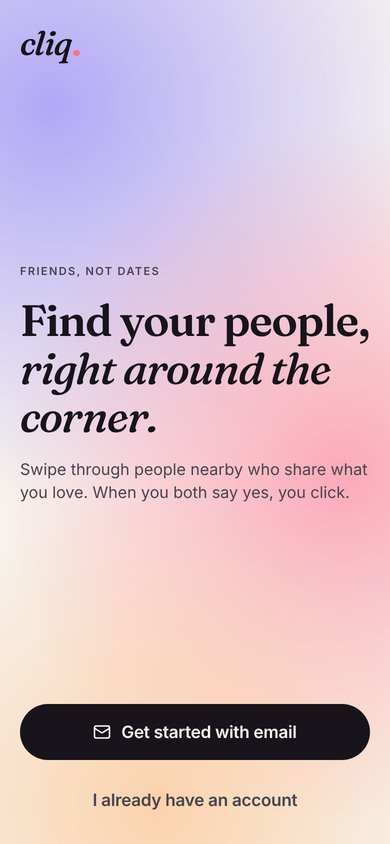
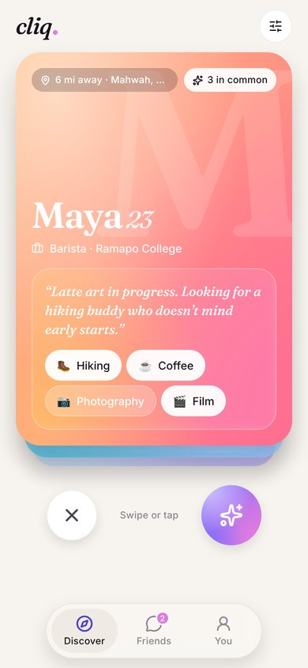
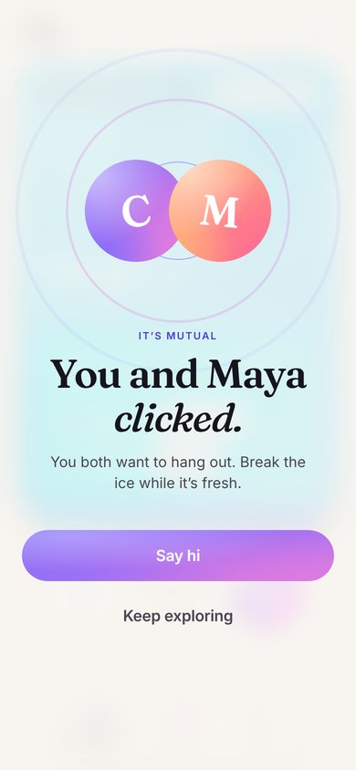
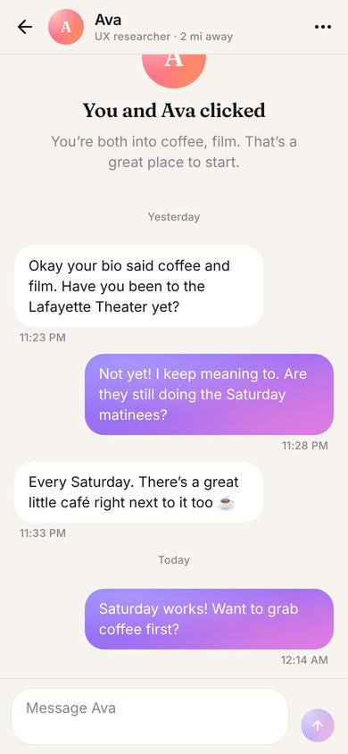

# Cliq — making friends has never been easier

Cliq is a swipe app for **platonic** connections. You build a card that shows who you are (no photo contest, just your interests, your day-to-day and a two-color palette), swipe through people nearby, and when you both say yes, you *click* and can start talking.

This is Cliq 2.0: a ground-up redesign of the [2024 senior project](docs/Cliq%20Senior%20Project%20Report.pdf) as a native app for iOS and Android plus a web version, all from one codebase. The original Next.js app is kept in [`legacy/`](legacy) for reference.

<p>
  
  
  
  
</p>

## What's inside

```
apps/
  mobile/   Expo (SDK 58) app for iOS, Android and web — Expo Router, Reanimated, Gesture Handler
  server/   Cliq API — Hono on Node, Postgres, WebSockets, our own auth
legacy/     The original Next.js + Xata + Clerk app
docs/       Senior project report, test plan, redesign screenshots
```

### The app

- **Onboarding** in seven short steps that save as you go: name, birthday, gig, interests, palette (with a live card preview), bio, location.
- **Discover**: a physics-based swipe deck with haptics, "Let's hang" / "Not now" stamps, tap buttons for people who'd rather not drag, and the original session stats.
- **It's mutual**: a match moment where both palettes meet, then straight into chat.
- **Friends and chat**: realtime messages over WebSockets, typing indicator, read receipts, online status ("Online now", "Active 5 minutes ago"), photos and GIFs, grouped bubbles tinted with your palette, unmatch, and report-and-block.
- **More than a card** (from the original wishlist): answer up to three prompts, feature a song (with a 30 second preview), TV show or movie from Apple's catalog, and earn achievements whose badges show on your card. Tap the arrow on a card to see someone's whole profile.
- **Distance from where you are**: when you open Cliq, your spot follows you (only if you've allowed location, and you can switch it off) instead of staying at a fixed home location.
- **Your palette themes everything**, just like the original: buttons, accents, sliders and chat bubbles all follow the two colors you pick.
- **Optional photo**: pick or take one, cropped to the card's shape and re-encoded on device (which also strips GPS metadata), then faded into your palette so the colors still lead.
- **Native touches**: Face ID / fingerprint app lock, Keychain/Keystore token storage, Sign in with Apple and Google, one-time-code autofill for email codes, push notifications for matches and messages, on-device reverse geocoding, light and dark mode.
- **Your controls**: take a break from Discover (a day, a week, or until you're back), notification switches, light/dark/automatic theme, undo your last swipe, block without reporting, a list of signed-in devices with per-device sign out, and a download of all your data.
- **Web**: the same screens with a sidebar layout on wide windows; mouse drag and keyboard (Enter to send) work.

### The API (no third-party auth or database service)

| Concern | How it's done |
| --- | --- |
| Passwords | scrypt (N=2^15) with per-user salt, constant-time compare, dummy hash for unknown emails |
| Sessions | 15-minute HS256 access tokens plus single-use 30-day refresh tokens stored as SHA-256 hashes. Reusing a rotated refresh token revokes the whole session family |
| Social sign-in | Apple and Google identity tokens verified against the providers' public keys |
| Email | 6-digit codes to confirm your address and to reset a forgotten password. Codes are HMAC-hashed, expire in 15 minutes, allow 5 guesses and can be resent every 45 seconds. Swiping and messaging wait until the email is confirmed. "Forgot password" answers the same whether or not an account exists |
| Passwordless | "Email me a sign-in code instead" signs you in with a one-time email code, same limits as the other codes |
| Two-step verification | Optional authenticator-app codes (TOTP, works with Google Authenticator, 1Password, Authy and others) at every sign in, including Apple, Google and email-code sign in. The secret is encrypted at rest (AES-256-GCM), each code works once, and 10 single-use backup codes cover a lost phone |
| New-device alerts | An email when your account signs in from a device it hasn't seen before |
| Chat media | Photos are shrunk and re-encoded on device; GIFs from your library are sent as-is (up to 6 MB). Both are stored by the API, served from unguessable URLs, and disappear when either person unmatches. GIF search uses GIPHY when `GIPHY_API_KEY` is set |
| Featured picks | Searched through Apple's free iTunes Search API (no key). Only Apple artwork and preview links are accepted, so a profile can't load arbitrary images on other people's phones |
| Achievements | Worked out from what you've actually done (matches, messages, profiles seen and so on), so there's nothing to award or backfill |
| Photos | Stored by the API itself (no bucket service). Type is checked from the file's bytes, capped at 2 MB, served with a versioned immutable cache URL |
| Abuse | Rate limits per address and per account on sign in and resets, spam limits on messages and swipes, block and report, profiles reported by 3 different people are hidden pending review, teens (13–17) and adults never see each other |
| Sessions | Revoking a device or changing your password cuts it off on its next request. Deleting your account asks for your password |
| Location | Coarsened to ~1km before storage; others only ever see whole miles. No geocoding API needed |
| Discovery | Bounding box in SQL, exact distance and mutual age/radius preferences in code, ranked by an evolved version of the original scoring algorithm |
| Realtime | WebSocket hub with first-message auth, Expo push fallback when the other person is offline |
| Database | Plain SQL migrations. Runs on any Postgres via `DATABASE_URL`, or embedded PGlite with zero setup |

## Getting started

You need Node 20+. From the project folder:

```bash
npm install   # installs the API and the app
npm start     # starts both; scan the QR code with Expo Go, or press w for web
```

Sign in with **demo@cliq.app / cliq-demo-2024**. The first run fills the local database with a dozen people around Mahwah, NJ, and Maya, Jordan, Theo, Riley and Diego have already liked the demo account, so swiping right on them makes a match. When you sign up a new account, the email code is printed in the terminal (set `SMTP_URL` to send real email).

Two processes run side by side: the **app** (Expo, which hands the code to your phone) and the **API** (the backend with the database, sign in, matching and chat). `npm run demo` starts only the app with built-in sample data instead of the API (every email and authenticator code is 246810), handy for a quick look.

On a phone, the app talks to the API on the same machine that runs Metro. Set `EXPO_PUBLIC_API_URL` to point it somewhere else.

### Native builds

Sign in with Apple, Face ID, and push notifications need a development build rather than Expo Go:

```bash
cd apps/mobile
npx eas-cli@latest build --profile development --platform ios
```

Push notifications also need an EAS project id (`npx eas-cli init`). Set `APPLE_AUDIENCES` on the server to your bundle id (`fi.cliq.app`).

For Google sign in, create OAuth client IDs in Google Cloud, put them in `apps/mobile/.env` (see [`.env.example`](apps/mobile/.env.example)) and in `GOOGLE_AUDIENCES` on the server. The button stays hidden until an id is set.

### Tests

```bash
cd apps/server && npm test        # auth, token rotation, email codes, password reset, two-step verification, photos, discovery, matching, chat
cd apps/mobile && npx tsc --noEmit
```

## Configuration

See [`apps/server/.env.example`](apps/server/.env.example). In production, `JWT_SECRET` must be a random string of at least 32 characters and `DATABASE_URL` should point at a managed Postgres.

## Hosting

The database runs on **Supabase** (project `cliq`), used purely as managed Postgres; sign in, matching and chat stay in this API. Every table has row level security switched on with no policies, so Supabase's public REST API can't read anything. Only the API, connecting as the owner, can.

1. In Supabase, open **Project Settings → Database**, set a database password, and copy the **Session pooler** connection string.
2. Deploy the API. With [Render](https://render.com), choose **New → Blueprint** and pick this repo: [`render.yaml`](render.yaml) builds [`apps/server/Dockerfile`](apps/server/Dockerfile). Paste the connection string as `DATABASE_URL`, and set `SMTP_URL` for email. Any host that runs Docker works the same way.
3. Point the app at it with `EXPO_PUBLIC_API_URL=https://your-api.onrender.com`.

## What's next

- Deploying the API (any Node host with Postgres and an SMTP sender) and the web build (`npm run export:web`, then any static host)
